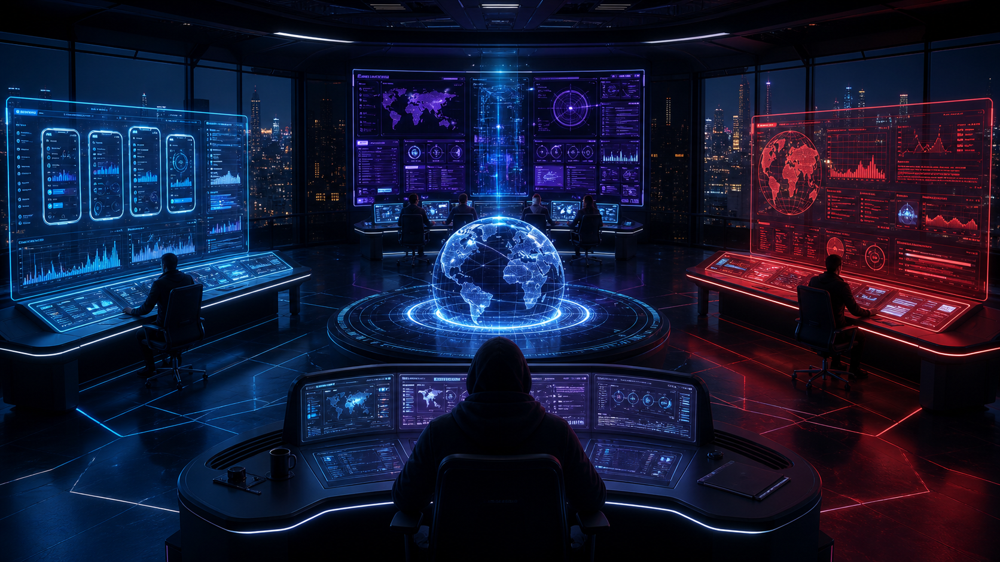

# MONTE WO Intelligence Command Center — Visual README

**Status: visual target / concept + implementation contract.** This document defines the intended presentation for the private ARGON / ULTRON / AU command center and how the working 3D room implements it. It is not evidence that the system is deployed to production — the room runs in the private preview only.

## Visual target

The room should feel like a premium, cinematic, futuristic operations floor:
- dark navy/near-black architecture with electric-blue light for ARGON, red for ULTRON, and gold/violet accents for AU;
- central AU coordination zone with a holographic globe/table;
- ARGON's blue-lit mobile-app workstation on one side;
- ULTRON's red-lit website-health workstation on the other;
- the human owner/operator — **Vitaflex (Sony)** — seated at the central command position. He is a person, not an AI agent, and is never portrayed as one;
- TITAN, the app-improvement agent, at a distinct side station: research and proposals only, nothing applied without the owner's approval;
- large transparent holographic screens with readable, evidence-backed operational information;
- a clear operator UI around the 3D scene: activity feed, agent status, incidents, and AU briefing.

*Concept image — visual direction only. It contains sample metrics that are NOT real data; nothing from it is copied into the product as live values.*

## Implementation status (honest)

- **Implemented and verified** (private preview, `#/room`): dependency-free 3D room (canvas, orbit/zoom camera, reduced-motion support); ARGON left, ULTRON right, AU central, TITAN at a distinct side station, operator station for Vitaflex (Sony); holographic screens driven by the authenticated API (overview, timeline, incidents, improvements, briefings); avatar states computed from real run data; "What's real right now" explains every animation with the real fact behind it; click-through to run history; real action buttons (`POST /verify`, `POST /improve`); 2D views remain the complete, accessible source of truth.
- **Not yet implemented**: the toggleable, watermarked SIMULATION/DEMO mode with isolated synthetic fixtures; the typed event→animation map as a tested contract; the scripted end-to-end acceptance scenario. These are tracked in PR #16 and must land before the room is called complete.
- **Not connected (stated, never faked)**: Web/traffic analytics (`NOT CONNECTED` on ULTRON's screen until an aggregate-only provider integration exists) and mobile telemetry (ARGON shows `IDLE / WAITING` until the consent-gated client ships in the app).

## What the room must animate

Movement must be driven by the agent state/event model, not arbitrary choreography:
- `idle`: agent remains at its home station; screen says "Idle / Waiting for data".
- `task_started`: agent walks to the relevant holographic screen.
- `evidence_received`: screen adds the event/evidence item and timestamp.
- `analysis_running`: agent examines the screen; show a progress state tied to a real job.
- `finding_created`: show the persisted finding and its confidence/evidence links.
- `correlation_started`: AU moves to the shared central display and shows the actual member events.
- `briefing_created`: AU's screen shows the persisted briefing and recommendation decisions.
- `task_failed`: agent shows an explicit error state and a route to logs.
- `recovered`: show recovery only after the actual recovery rule passes.

Do not represent a scheduled job as running until a job has actually started. Do not invent live timestamps, counts, uptime, incidents, confidence, traffic, or results.

## Reality labels

Every screen and API payload must expose one of:
- **LIVE** — backed by configured production-like telemetry/checks and persisted evidence.
- **SIMULATION / DEMO** — synthetic events, visibly watermarked, isolated from production records.
- **NOT CONNECTED / NOT CONFIGURED** — integration or data source is absent.
- **IDLE / WAITING** — no active job/event exists.

Never blend demo and live data in the same metric or briefing. Include a visible mode indicator at all times and ensure demo records cannot trigger production automation.

## Interactions

- Clicking an agent opens its last run, current task, timestamps, evidence, result, errors, and next scheduled run.
- Clicking a holographic incident opens its persisted incident record and timeline.
- Clicking an AU correlation opens the linked source events and the explanation for why they were grouped.
- An event timeline entry explains the event that caused an agent to move/change state.
- The room must work with keyboard navigation and reduced-motion settings; a 2D operational view remains available when 3D rendering is unsupported or expensive.

## Acceptance test

A repeatable test must create a test-only incident through the actual API, have ARGON or ULTRON process it, have AU correlate/summarize it, persist the result, and let the operator inspect the complete evidence chain in the UI. Automated tests must verify live/demo isolation, authorization, idle/failure states, and event-to-animation mapping.

## Security / deployment guardrails

- The room and all intelligence APIs remain private behind Cloudflare Access and server-side role checks.
- Keep demo fixtures clearly synthetic and separate from production storage/automation.
- Do not deploy publicly just to produce a shareable preview.
- Do not claim live integrations until they are configured and verified.
- Keep automation disabled by default and never let visual animation trigger an action.
- Document Cloudflare bindings, migrations, secrets, and a realistic no-recurring-cost path before deployment.

## Source of truth

The implementation and runbook are tracked in [PR #16](https://github.com/vitaflexl4-ai/monte-wo/pull/16) and `docs/INTELLIGENCE-COMMAND-CENTER.md`. This README is the visual/interaction acceptance contract, not a deployment claim.

## Living portal — implemented behavior (2026-10-25)

The approved concept image is treated as the visual specification. The room is a continuously
rendered, interactive 3D environment — not a static background, not a dashboard replacement.

**Typed lifecycle (movement is event-driven, never random activity).** Every operator action
runs a real server-side job and drives avatars through explicit phases:
`task-assigned → investigating → evidence-found → reporting → task-completed`
(`presenting-briefing` for AU at the owner station; `task-failed` on real API rejection,
including honest 429 rate-limit handling). The `investigating` phase spans the actual in-flight
request (with a minimum visual hold for pacing only). Phase verbs appear on the station tag
chips and the HUD "what's real" column. Idle agents look idle; the only idle motion is ambient
(particle drift, station light breathing, screen refresh, deterministic AU station patrol) and
never implies work.

**Interactive surfaces open the real application.** Every holographic screen, the globe chip,
and table incident cards are clickable (mouse + keyboard) and route to the real 2D views:
ARGON → `#/analysis`, ULTRON → `#/agents`, AU + owner console → `#/briefings`, TITAN → `#/titan`,
globe → `#/overview`, incidents → `#/incidents`. Name tags open the agent's real run detail.

**DEMO mode is watermarked and isolated.** A toggle runs synthetic demo tasks client-side only:
zero API calls (asserted in tests), zero writes, visibly labeled `SIMULATION / DEMO` pill,
diagonal watermark, dashed purple demo cards, `DEMO ·`-prefixed chips, and a badge explaining
that production records are untouched. Demo tasks never interrupt real tasks. The 60s app
auto-refresh no longer remounts the room (a navigation-epoch guard also protects all views
from stale async renders), so simulation state and in-flight tasks survive refreshes.

**Inspection hook.** `window.MWRoom.state()` exposes `{ demo, agents: { phase, mode, x, z } }`
for tests and operator verification.

**E2E coverage** (`tests/intelligence-browser.mjs`): real run → investigating during the
in-flight POST → result card at the table → persisted `agent-run` evidence in the timeline →
AU briefing presented at the owner station; screen click → real 2D route; demo mode →
watermark + zero POSTs + auto-refresh survival; honest task-failed path on 429.
